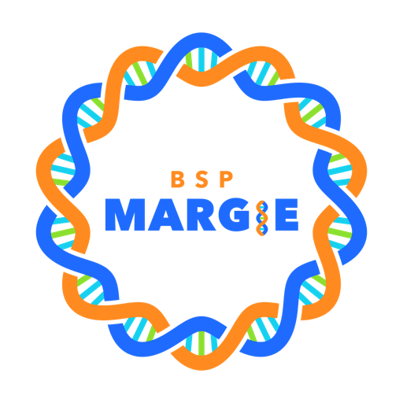
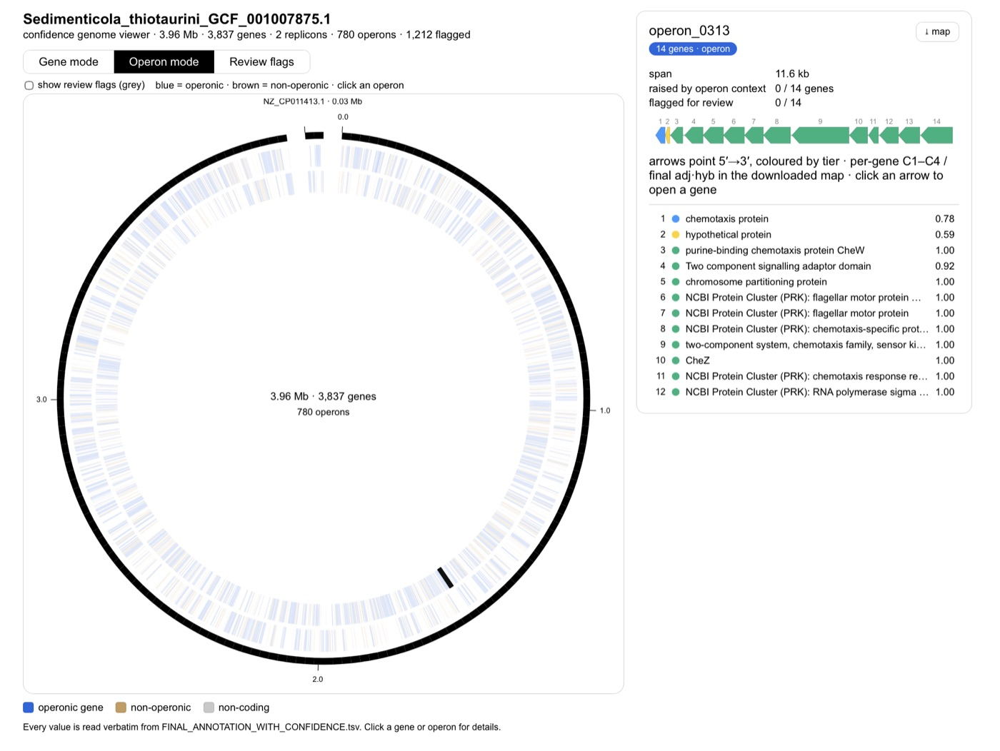

<div align="center">



# MARGIE

**Mostly Automated Rapid Genome Inference Environment**

Annotates prokaryotic genomes with many tools at once, finds operons, and scores how much the
evidence agrees, gene by gene.

[](https://github.com/wintermutant/bioinformatics-tools)
[](https://bioinformatics-tools.readthedocs.io/en/latest/)
[](LICENSE)
<br>
[](https://snakemake.readthedocs.io/)
[](https://www.python.org/)
[](https://fastapi.tiangolo.com/)
[](https://svelte.dev/)
[](https://www.typescriptlang.org/)
[](https://tailwindcss.com/)
[](https://apptainer.org/)
[](https://slurm.schedmd.com/)

</div>

MARGIE is a part of the **[Bioinformatics Supercomputing Platform (BSP)](https://github.com/wintermutant/bioinformatics-tools)**
by Dane Deemer ([wintermutant](https://github.com/wintermutant)): a Snakemake workflow housed, among
other tools, in BSP's engine. BSP's documentation is on
**[Read the Docs](https://bioinformatics-tools.readthedocs.io/en/latest/)**.

<div align="center">
<picture>
  <source media="(prefers-color-scheme: dark)" srcset="fe-margie/margie-fe/static/home/genome-map-dark.webp">
  
</picture>
</div>

A product of the Diet-Microbiome Interactions Lab, Purdue University. PI: Stephen R Lindemann
(lindems@purdue.edu).

| Folder | What it is |
|---|---|
| [`be-margie/`](be-margie) | The MARGIE(SB) Snakemake pipeline, the `dane_wf` command line, and the API the interface talks to. |
| [`fe-margie/`](fe-margie) | The interface (SvelteKit), run as a website. |

MARGIE runs on an HPC cluster with SLURM and Apptainer, or on your own computer with the desktop app.

## Using the website

**[margie.geddes.rcac.purdue.edu](https://margie.geddes.rcac.purdue.edu)** runs the code in this
repository. Its hosting setup is kept in a separate, private repository.

1. Sign in with your Purdue cluster account. Outside Purdue, ask for an account at lindems@purdue.edu.
2. **Install**: read the licences, type the statement, and check your cluster setup.
3. **Settings**: your SLURM account, folders and databases.
4. **Analyze**: choose genomes and tools, then start the run.
5. **Jobs** follows the run; **Results** holds the tables, figures and genome map.

## Using the Desktop App

Download the installer for your system from
**[Releases](https://github.com/Diet-Microbiome-Interactions-Lab/margie-project-2026/releases/latest)**:

| File | For |
|---|---|
| `MARGIE-<version>-universal.dmg` | macOS, Apple silicon and Intel |
| `MARGIE-<version>-x64-setup.exe` | Windows 10 and 11 (x64) |
| `MARGIE-<version>-win.zip`, `MARGIE-<version>-arm64-win.zip` | Windows x64 and ARM, portable |
| `MARGIE-<version>-amd64.deb`, `MARGIE-<version>-arm64.deb` | Debian and Ubuntu |
| `MARGIE-<version>-x86_64.AppImage`, `MARGIE-<version>-arm64.AppImage` | Other Linux systems |

First launch (the apps are not code-signed yet):

- **macOS**: drag MARGIE to Applications, then right-click it and choose **Open**.
- **Windows**: at the SmartScreen notice, choose **More info**, then **Run anyway**. Install
  [Git for Windows](https://git-scm.com/download/win) first.
- **Linux**: `sudo apt install ./MARGIE-<version>-amd64.deb`, or `chmod +x` the AppImage and run it.

The start page asks where MARGIE runs:

- **This computer** (macOS and Linux): needs Docker Desktop, Podman or Apptainer. Install builds
  the tools and downloads their databases. The build files come locked in the app; ask
  lindems@purdue.edu for the password.
- **HPC cluster**: give your login (`you@cluster.address`). MARGIE sets up her backend in your
  cluster home folder over SSH, then you sign in or create a MARGIE account.

Install opens once you type its statement. RASTtk, Prodigal, Pfam, COG, PGAP, GTDB-Tk, QUAST, the
operon finder, the envelope stage and MARGIE's own scripts are open to use; the other tools install
and run once you accept their licences in **Settings → Licences**.

## Hosting the Desktop App Locally

Runs MARGIE's interface on your computer from this repository, working on your cluster account
over SSH. Needs Python 3.11, [uv](https://docs.astral.sh/uv/), Node.js 20 or newer, and SSH access
to the cluster.

**1. The API**, in MARGIE's uv environment (`be-margie/.venv`). `requirements.txt` lists its
Python packages with their versions.

```bash
cd be-margie
uv venv --python 3.11
uv pip install -r requirements.txt -e .
cp .env.example .env      # set BSP_SECRET_KEY and BSP_ENCRYPTION_KEY (the file says how)
.venv/bin/dane-api        # listens on port 8000
```

**2. The interface**

```bash
cd fe-margie/margie-fe
npm ci
VITE_PUBLIC_API_URL=http://localhost:8000 npm run dev      # open http://127.0.0.1:5173
VITE_PUBLIC_API_URL=http://localhost:8000 npm run build    # or: static files in build/
```

Serve `build/` with a web server that sends `/v1` on the same address to the API. Then sign in as
on the website.

## Running from the Command Line

On the cluster:

```bash
git clone https://github.com/Diet-Microbiome-Interactions-Lab/margie-project-2026.git ~/margie-project-2026
ln -s ~/margie-project-2026/be-margie ~/bioinformatics-tools
cd ~/bioinformatics-tools
uv sync
source .venv/bin/activate

dane_wf        # the first time: creates ~/.config/bioinformatics-tools/config.yaml
```

Set your folders and databases in that file (see [be-margie/README.md](be-margie/README.md#configure)),
then run:

```bash
dane_wf margie sb \
  input: path-to-input-folder-or-fasta \
  output_dir: path-to-output-folder
```

### Choosing the tools

Without a list, a run uses `margie_sb.default_selected_tools` from your config.yaml, or else the
tools up to scoring. To choose, list them by name, separated by commas:

```bash
dane_wf margie sb \
  input: path-to-input-folder-or-fasta \
  output_dir: path-to-output-folder \
  margie_sb.selected_tools: gtdbtk,rasttk,cog,kegg,eggnog,uniprot,pfam,tigrfam,dbcan,pgap,geneprop,interpro,operon,envelope,consolidation,labeling,fingerprint,scoring_heuristic,fingerprint_database
```

| Phase | Tools |
|---|---|
| 1. Assembly quality | `quast` |
| 2. Taxonomy | `gtdbtk`: each genome's domain and genetic code. Without it, give them in `margie_sb.genome_info`, or Prodigal calls that genome's genes. |
| 3. Gene calling | `rasttk` (keep it in the list) |
| 4. Annotation | `cog`, `kegg`, `eggnog`, `uniprot`, `pfam`, `tigrfam`, `merops`, `tcdb`, `dbcan`, `pgap`, `geneprop`, `interpro` |
| 5. Operons | `operon` |
| 6. Topology and signal peptides | `phobius`, `tmbed`, `signalp6` |
| 7. Cell envelope | `envelope` |
| 8. Localisation | `psortb`, `deepsig`, `signalp4` |
| 9 to 13. Consensus and confidence | `consolidation`, `labeling`, `fingerprint`, `scoring_heuristic`, `fingerprint_database` |

A run includes the phase 4 tools that scoring reads (COG, KEGG, eggNOG, UniProt, Pfam, TIGRFAMs,
PGAP, InterPro, dbCAN), the operons and the envelope stage, chosen or not. Keep phases 9 to 13 in
the list to get each gene's confidence score.

On the first run, MARGIE shows each tool's and database's licence and asks you to accept them;
tools you are not licensed for are turned off (Phobius, SignalP 4 and 6 and MEROPS need your own
licence; for commercial use, TMbed, TCDB and KEGG too). Configuration, background runs and the
other options: [be-margie/README.md](be-margie/README.md).

## Acknowledgements

I (Sajal) gratefully acknowledge Dane Deemer ([wintermutant](https://github.com/wintermutant)) for his mentoring, and the design and development of the engine and GUI orchestration platform on which the MARGIE(SB) workflow was built.

Special thanks goes to Dr. Stephen R Lindemann for his vision, supervision and support throughout this development.
I also thank members of Diet-Microbiome-Interactions Laboratory for their feedbacks and intellectual inputs during this development.

MARGIE's runs use research computing resources of the Rosen Center for Advanced Computing (RCAC), Information Technology at Purdue University: the Negishi community cluster and the Geddes Community Composable Platform, which the National Science Foundation funded under award [OAC-2018926](https://www.nsf.gov/awardsearch/showAward?AWD_ID=2018926) (CC* Compute: Private Campus Cloud for Data Analytics and Machine Learning). We thank RCAC and its staff for these resources and their support.

MARGIE was developed with support from the U.S. National Science Foundation under [Grant No. 2125155](https://www.nsf.gov/awardsearch/showAward?AWD_ID=2125155) (MIM: Microbial Division of Labor in Polysaccharide-Degrading Communities) and the National Institute of General Medical Sciences of the National Institutes of Health under [Award No. R35 GM133634](https://reporter.nih.gov/project-details/10645210) (Carbohydrate Structure Controls on Human Gut Microbial Ecology); PI: Stephen R. Lindemann.

We also thank the developers and maintainers of the upstream tools, databases, and scientific software used throughout the pipeline. Their contributions make reproducible computational biology more powerful, more accessible, and more exciting to do.

MARGIE is built with open-source software: [Snakemake](https://snakemake.github.io) (with its SLURM executor plugin), [Apptainer](https://apptainer.org), [Slurm](https://slurm.schedmd.com), [Python](https://www.python.org) and [uv](https://docs.astral.sh/uv/); [Biopython](https://biopython.org), [NumPy](https://numpy.org), [pandas](https://pandas.pydata.org), [SciPy](https://scipy.org), [Matplotlib](https://matplotlib.org) and [openpyxl](https://openpyxl.readthedocs.io); [FastAPI](https://fastapi.tiangolo.com), [Uvicorn](https://www.uvicorn.org), [Pydantic](https://docs.pydantic.dev), [Paramiko](https://www.paramiko.org), [Typer](https://typer.tiangolo.com) and [PyYAML](https://pyyaml.org); [Svelte and SvelteKit](https://svelte.dev), [TypeScript](https://www.typescriptlang.org), [Vite](https://vite.dev), [Tailwind CSS](https://tailwindcss.com), [Skeleton](https://www.skeleton.dev), [Flowbite Svelte](https://flowbite-svelte.com), [Lucide](https://lucide.dev), [xterm.js](https://xtermjs.org), [marked](https://marked.js.org), [DOMPurify](https://github.com/cure53/DOMPurify), [ExcelJS](https://github.com/exceljs/exceljs) and [Fontsource](https://fontsource.org); and [MkDocs](https://www.mkdocs.org) with [Material for MkDocs](https://squidfunk.github.io/mkdocs-material/) for the documentation. Thank you to each of these projects.

## Citations

APA 7th (this pipeline):

Bhattarai, S., Deemer, D., & Lindemann, S. R. (2026). *MARGIE: Mostly Automated Rapid Genome Inference Environment* [Computer software]. Purdue University. https://github.com/Diet-Microbiome-Interactions-Lab/margie-project-2026

APA 7th (thesis, in which MARGIE was first built):

Bhattarai, S. (2026). *Mostly Automated Rapid Genome Inference Environment* [Thesis, Purdue University]. Purdue University Graduate School. https://doi.org/10.25394/PGS.33103682.v1

APA 7th (the code and data as the thesis used and cites them):

- Bhattarai, S., Deemer, D., & Lindemann, S. (2026a). *bioinformatics-tools* (Version 1.0.0) [Computer software]. https://github.com/sajalbhattarai/bioinformatics-tools/releases/tag/v.1.0.0
- Bhattarai, S., Deemer, D., & Lindemann, S. (2026b). *biolab-fe* (Version 1.0.0) [Computer software]. https://github.com/sajalbhattarai/biolab-fe/releases/tag/v1.0.0
- Bhattarai, S., Deemer, D., & Lindemann, S. (2026c). *Mostly Automated Rapid Genome Inference Environment* [Dataset]. Zenodo. https://doi.org/10.5281/zenodo.21632205 (embargoed until 30 August 2028)

APA 7th (base architecture on which MARGIE was built, by Dane Deemer):

- Deemer, D. (2020). *bioinformatics-tools* [Computer software]. GitHub. https://github.com/wintermutant/bioinformatics-tools (the backend that be-margie grew from: API, command line and workflow engine)
- Deemer, D. (2025). *biolab-fe* [Computer software]. GitHub. https://github.com/wintermutant/biolab-fe (the web interface that fe-margie grew from)

APA 7th (research computing):

- McCartney, G., Hacker, T., & Yang, B. (2014). Empowering faculty: A campus cyberinfrastructure strategy for research communities. *EDUCAUSE Review*. https://er.educause.edu/articles/2014/7/empowering-faculty-a-campus-cyberinfrastructure-strategy-for-research-communities
- Smith, P. M., Gough, E., Younts, A., Werts, B., Hacker, T. J., Neumeister, N., & Wisecaver, J. (2020). The “Geddes” composable platform: An evolution of community clusters for a composable world. *2020 IEEE/ACM International Workshop on Interoperability of Supercomputing and Cloud Technologies (SuperCompCloud)*, 33–38. https://doi.org/10.1109/SuperCompCloud51944.2020.00011
- Rosen Center for Advanced Computing. (n.d.). *Negishi* [Community cluster]. Purdue University. Retrieved October 25, 2026, from https://www.rcac.purdue.edu/compute/negishi

BibTeX:

```bibtex
@article{Bhattarai2026,
author = "Sajal Bhattarai",
title = "{MOSTLY AUTOMATED RAPID GENOME INFERENCE ENVIRONMENT}",
year = "2026",
month = "7",
url = "https://hammer.purdue.edu/articles/thesis/_b_MOSTLY_AUTOMATED_RAPID_GENOME_INFERENCE_ENVIRONMENT_b_/33103682",
doi = "10.25394/PGS.33103682.v1"
}
@software{Bhattarai2026aBioinformaticsTools,
author = "Sajal Bhattarai and Dane Deemer and Stephen Lindemann",
title = "{bioinformatics-tools}",
version = "1.0.0",
year = "2026",
url = "https://github.com/sajalbhattarai/bioinformatics-tools/releases/tag/v.1.0.0"
}
@software{Bhattarai2026bBiolabFe,
author = "Sajal Bhattarai and Dane Deemer and Stephen Lindemann",
title = "{biolab-fe}",
version = "1.0.0",
year = "2026",
url = "https://github.com/sajalbhattarai/biolab-fe/releases/tag/v1.0.0"
}
@misc{Bhattarai2026cData,
doi = {10.5281/ZENODO.21632205},
url = {https://zenodo.org/doi/10.5281/zenodo.21632205},
author = {Bhattarai, Sajal and Deemer, Dane and Lindemann, Stephen},
title = {Mostly Automated Rapid Genome Inference Environment},
publisher = {Zenodo},
year = {2026},
note = {Embargoed until 2028-08-30}
}
@software{Deemer2020,
author = "Dane Deemer",
title = "{bioinformatics-tools}",
year = "2020",
publisher = "GitHub",
url = "https://github.com/wintermutant/bioinformatics-tools"
}
@software{Deemer2025,
author = "Dane Deemer",
title = "{biolab-fe}",
year = "2025",
publisher = "GitHub",
url = "https://github.com/wintermutant/biolab-fe"
}
@article{McCartney2014,
author = {McCartney, Gerry and Hacker, Thomas and Yang, Baijian},
journal = {Educause Review},
title = {{Empowering Faculty: A Campus Cyberinfrastructure Strategy for Research Communities}},
year = {2014},
url = {https://er.educause.edu/articles/2014/7/empowering-faculty-a-campus-cyberinfrastructure-strategy-for-research-communities}
}
@inproceedings{Smith2020Geddes,
title = {The “Geddes” Composable Platform - An Evolution of Community Clusters for a Composable World},
url = {http://dx.doi.org/10.1109/SuperCompCloud51944.2020.00011},
DOI = {10.1109/supercompcloud51944.2020.00011},
booktitle = {2020 IEEE/ACM International Workshop on Interoperability of Supercomputing and Cloud Technologies (SuperCompCloud)},
publisher = {IEEE},
author = {Smith, Preston M. and Gough, Erik and Younts, Alexander and Werts, Brian and Hacker, Thomas J. and Neumeister, Norbert and Wisecaver, Jennifer},
year = {2020},
month = nov,
pages = {33--38}
}
@misc{RCACNegishi,
author = {{Rosen Center for Advanced Computing}},
title = {Negishi community cluster},
howpublished = {Purdue University},
url = {https://www.rcac.purdue.edu/compute/negishi},
note = {Accessed 2026-10-25}
}
```

Use the exact version you ran by checking repository Releases, and include that release version number in your citation.

Please also cite the individual tools and databases you use in the MARGIE pipeline, in accordance with their licensing and referencing requirements. The licensing gates during MARGIE runs provide the relevant licensing details, but you should still cross-check and confirm the requirements before publication.

For machine-readable repository metadata, see [CITATION.cff](CITATION.cff).

## AI usage in the project

Phase 9-12 scripts were designed and implemented by **Sajal Bhattarai**.
During script development, **Claude Sonnet 4.6** was used in interactive mode to improve robustness and debug issues.
The core ideas, architecture, and intended behavior were defined by Sajal Bhattarai.
These scripts were manually validated for intended behavior.

Visualization and LLM work, including the operon circular diagram page, HTML creation, and interactive chat mode, were refined with interactive-mode assistance from **Claude Opus 4.8**.
These components were also manually checked and validated for intended purpose.

## Disclaimer

This software is provided "as is", without warranty of any kind, express or implied, including but not limited to warranties of merchantability, fitness for a particular purpose, and noninfringement.
