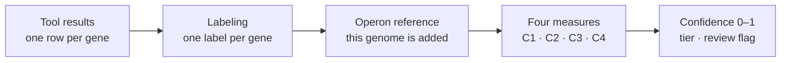

<div align="center">


# MARGIE

**Mostly Automated Rapid Genome Inference Environment**

Annotates prokaryotic genomes with many tools at once, finds operons, and scores how much the
evidence agrees, gene by gene.

[](https://github.com/wintermutant/bioinformatics-tools)
[](https://bioinformatics-tools.readthedocs.io/en/latest/)
[](LICENSE)
<br>
[](https://snakemake.readthedocs.io/)
[](https://www.python.org/)
[](https://fastapi.tiangolo.com/)
[](https://svelte.dev/)
[](https://www.typescriptlang.org/)
[](https://tailwindcss.com/)
[](https://apptainer.org/)
[](https://slurm.schedmd.com/)

</div>

MARGIE is a part of the **[Bioinformatics Supercomputing Platform (BSP)](https://github.com/wintermutant/bioinformatics-tools)**
by Dane Deemer ([wintermutant](https://github.com/wintermutant)): a Snakemake workflow housed, among
other tools, in BSP's engine. BSP's documentation is on
**[Read the Docs](https://bioinformatics-tools.readthedocs.io/en/latest/)**.

<div align="center">
<picture>
  <source media="(prefers-color-scheme: dark)" srcset="fe-margie/margie-fe/static/home/genome-map-dark.webp">
  
</picture>
</div>

A product of the Diet-Microbiome Interactions Lab, Purdue University. PI: Stephen R Lindemann
(lindems@purdue.edu).

| Folder | What it is |
|---|---|
| [`be-margie/`](be-margie) | The MARGIE(SB) Snakemake pipeline, the `dane_wf` command line, and the API the interface talks to. |
| [`fe-margie/`](fe-margie) | The interface (SvelteKit), run as a website. |

MARGIE runs on an HPC cluster with SLURM and Apptainer.

## Running from the Command Line

On the cluster:

```bash
git clone https://github.com/Diet-Microbiome-Interactions-Lab/margie-project-2026.git ~/margie-project-2026
ln -s ~/margie-project-2026/be-margie ~/bioinformatics-tools
cd ~/bioinformatics-tools
uv sync
source .venv/bin/activate

dane_wf        # the first time: creates ~/.config/bioinformatics-tools/config.yaml
```

Set your folders and databases in that file (see [be-margie/README.md](be-margie/README.md#configure)),
then run:

```bash
dane_wf margie sb \
  input: path-to-input-folder-or-fasta \
  output_dir: path-to-output-folder
```

### Choosing the tools

Without a list, a run uses `margie_sb.default_selected_tools` from your config.yaml, or else
every tool up to scoring. To choose, list them by name, separated by commas:

```bash
dane_wf margie sb \
  input: path-to-input-folder-or-fasta \
  output_dir: path-to-output-folder \
  margie_sb.selected_tools: gtdbtk,rasttk,cog,kegg,eggnog,uniprot,pfam,tigrfam,dbcan,pgap,geneprop,interpro,operon,envelope,consolidation,labeling,fingerprint,scoring_heuristic,fingerprint_database
```

| Phase | Tools |
|---|---|
| 1. Assembly quality | `quast` |
| 2. Taxonomy | `gtdbtk`: each genome's domain and genetic code. Without it, give them in `margie_sb.genome_info`, or Prodigal calls that genome's genes. |
| 3. Gene calling | `rasttk` (keep it in the list) |
| 4. Annotation | `cog`, `kegg`, `eggnog`, `uniprot`, `pfam`, `tigrfam`, `merops`, `tcdb`, `dbcan`, `pgap`, `geneprop`, `interpro` |
| 5. Operons | `operon` |
| 6. Topology and signal peptides | `phobius`, `tmbed`, `signalp6` |
| 7. Cell envelope | `envelope` |
| 8. Localisation | `psortb`, `deepsig`, `signalp4` |
| 9 to 13. Consensus and confidence | `consolidation`, `labeling`, `fingerprint`, `scoring_heuristic`, `fingerprint_database` |

Keep phases 9 to 13 in the list to get each gene's confidence score.

On the first run, MARGIE shows the licence of every tool and database it uses and asks you to
accept them; tools you are not licensed for are turned off (Phobius, SignalP 4 and 6 and
MEROPS need your own licence; for commercial use, TMbed, TCDB and KEGG too). Configuration,
background runs and the full set of options: [be-margie/README.md](be-margie/README.md).

## Running the GUI locally

The interface runs on your own computer, with its API, and works on your cluster account over
SSH: each person signs in with their own cluster account and SSH key, and the API runs
everything on the cluster as them. You need Python 3.11 with [uv](https://docs.astral.sh/uv/),
Node.js 20 or newer, and SSH access to the cluster's login node.

**1. The API**

```bash
cd be-margie
uv sync
cp .env.example .env    # then set BSP_SECRET_KEY and BSP_ENCRYPTION_KEY (how to make them is in the file)
uv run dane-api         # listens on port 8000
```

**2. The interface**

```bash
cd fe-margie/margie-fe
npm ci
VITE_PUBLIC_API_URL=http://localhost:8000 npm run dev
```

Open http://127.0.0.1:5173. To serve it instead, `npm run build` writes static files to
`build/`: serve them with any web server, and send `/v1` on the same address to the API.

**3. Sign in**

Create an account with your cluster's login address, your cluster username and an SSH key for
it. The first time, MARGIE clones this repository into your home folder on the cluster
(`~/margie-project-2026`) and builds the pipeline's environment there; every run uses that
copy. Then follow the pages in order: Install (licences and checks), Settings, Analyze, Jobs
and Results. Resources shows your SLURM accounts, jobs and the partitions' free CPUs and memory.

A desktop app, for running MARGIE on your own computer, is coming soon.

## Using the website

**[margie.geddes.rcac.purdue.edu](https://margie.geddes.rcac.purdue.edu)**

## How scoring works

Every gene in the final table, `FINAL_ANNOTATION_WITH_CONFIDENCE.tsv`, carries one label, a confidence between 0 and 1, a tier and a review flag. They come from two steps that run after the tools have finished and their results have been merged into one row per gene.



### 1. Labeling: one name per gene

Each tool's best hit for a gene is the one with the lowest e-value, taken only if its description says something (not "hypothetical protein", a bare DUF, or "uncharacterized" without a function word). The label then comes from the first tool in this order whose best hit qualifies:

> **PGAP → NCBIfam → TIGRFAM → HAMAP → PIRSF → UniProt** (identity of at least 40%) **→ KEGG → eggNOG → RASTtk → Pfam → CDD → COG**

If no tool qualifies, the gene keeps the first description any tool gave, or "No DB hits". MEROPS, TCDB and dbCAN check the label (a shared word marks agreement) but do not set it. Labeling also gathers each gene's EC numbers into a consensus (full, majority, single source, or conflicting), records its operon from UniOP, and checks whether TIGRFAM, PGAP and NCBIfam, and eggNOG and COG, point the same way.

### 2. Scoring: four measures

| | Question it answers | How |
|---|---|---|
| **C1** tool coverage | How many independent sources describe this gene? | Sources with an informative hit ÷ 7 (RASTtk, COG, Pfam, KEGG, eggNOG, UniProt, and one shared slot for TIGRFAM, PGAP and NCBIfam) |
| **C2** operon probability | How sure is UniOP that the gene shares an operon with its neighbours? | Mean of its upstream and downstream pair probabilities; 0.5 outside an operon |
| **C3** operon context | Do these neighbours sit together in other genomes too? | The Bayesian estimate below, one value per operon |
| **C4** EC agreement | Do the tools that give an EC number agree? | 1 − (share of tool pairs whose EC numbers conflict, weighted by how many tools gave one) |

#### C3: learning from other genomes

C3 asks a simple question of every pair of neighbouring genes in an operon: *when two genomes both have these two functions, how often do they sit side by side?* MARGIE keeps the answer in its operon reference, built from every genome scored so far.

Think of each pair of functions as a coin whose bias we want to know. Each reference genome that has both functions is one toss, and "side by side" is heads. Starting from a Jeffreys prior, Beta(½, ½), a pair seen side by side in *k* of *n* genomes has the posterior Beta(*k* + ½, *n* − *k* + ½), and C3 uses its mean, (*k* + ½) / (*n* + 1). Few observations leave room for doubt, which the 5th percentile of the same posterior shows (written to the table as `c3_lowerbound`):

| Side by side in | Posterior mean | 95% lower bound |
|---|---|---|
| 1 of 1 genomes | 0.75 | 0.23 |
| 5 of 5 | 0.92 | 0.69 |
| 5 of 10 | 0.50 | 0.26 |
| 28 of 28 | 0.98 | 0.93 |

Functions that sit next to almost anything would look conserved by chance, so each pair is weighted by how much more often it is adjacent than its partners' overall numbers of neighbours predict: with *lift* = observed ÷ expected, the weight is *lift* / (*lift* + 1). A pair seen at chance level keeps half its value; one seen nine times more often than chance keeps 90%.

An operon's C3 is the geometric mean of its adjacent pairs, so one poorly supported link pulls the whole operon down. Single genes and operons made only of hypothetical proteins get 0.5, and an operon whose pairs have no support in the reference gets 0.

The genome being scored is added to the reference first and then left out of its own comparison, so each genome is compared with all the *others*. The reference grows with every new genome, so a genome scored early was compared with fewer; each records how many in `scoring/scored-against.json`, and Results offers to score it again once the reference has grown.

### 3. The confidence score

```text
preliminary = C1 × C4
context     = C2 × C3   for genes in an operon (two or more members), else 0
confidence  = preliminary + context, kept between 0 and 1
```

Operon context can only raise a score. Two genes as examples:

- 6 of 7 sources and agreeing EC numbers: 0.86 × 1 = **0.86 (high)**. In a well supported operon (C2 0.9, C3 0.8) it gains 0.72 and reaches **1.0 (highest)**.
- 2 of 7 sources: **0.29 (low)** on its own; in an operon with C2 0.85 and C3 0.6 it gains 0.51 and reaches **0.80 (high)**, the case where neighbours lend support to a thinly annotated gene.

| Tier | highest | high | medium | fair | low |
|---|---|---|---|---|---|
| Confidence | above 0.9 | above 0.7 | above 0.5 | above 0.3 | 0.3 or less |

A gene is flagged for review (`NEEDS_REVIEW?`, with the reason beside it) when its EC numbers conflict, its confidence is below 0.5, it sits in an operon that UniOP gives less than 0.5, or its operon is ambiguous and gave it no boost.

### Where it happens

| Step | Script |
|---|---|
| Choose the label | [`be-margie/bioinformatics_tools/workflow_tools/labeling/assign-canonical-label.py`](be-margie/bioinformatics_tools/workflow_tools/labeling/assign-canonical-label.py) |
| EC consensus | [`be-margie/bioinformatics_tools/workflow_tools/labeling/add-ec-consensus.py`](be-margie/bioinformatics_tools/workflow_tools/labeling/add-ec-consensus.py) |
| Operon of each gene | [`be-margie/bioinformatics_tools/workflow_tools/labeling/add-operon-info.py`](be-margie/bioinformatics_tools/workflow_tools/labeling/add-operon-info.py) |
| TIGRFAM/PGAP/NCBIfam and eggNOG/COG checks | [`be-margie/bioinformatics_tools/workflow_tools/labeling/add-cluster-agreement.py`](be-margie/bioinformatics_tools/workflow_tools/labeling/add-cluster-agreement.py) |
| Add the genome to the operon reference | [`be-margie/bioinformatics_tools/workflow_tools/scoring/update-occ-reference-depot.py`](be-margie/bioinformatics_tools/workflow_tools/scoring/update-occ-reference-depot.py) |
| C1 | [`be-margie/bioinformatics_tools/workflow_tools/scoring/score-c1-tool-coverage.py`](be-margie/bioinformatics_tools/workflow_tools/scoring/score-c1-tool-coverage.py) |
| C2 | [`be-margie/bioinformatics_tools/workflow_tools/scoring/score-c2-operon-probability.py`](be-margie/bioinformatics_tools/workflow_tools/scoring/score-c2-operon-probability.py) |
| C3 and the operon reference | [`be-margie/bioinformatics_tools/workflow_tools/scoring/c3_score_organism.py`](be-margie/bioinformatics_tools/workflow_tools/scoring/c3_score_organism.py), [`be-margie/bioinformatics_tools/workflow_tools/scoring/c3_occ.py`](be-margie/bioinformatics_tools/workflow_tools/scoring/c3_occ.py), [`be-margie/bioinformatics_tools/workflow_tools/scoring/c3_lib.py`](be-margie/bioinformatics_tools/workflow_tools/scoring/c3_lib.py) |
| C4 | [`be-margie/bioinformatics_tools/workflow_tools/scoring/score-c4-ec-agreement.py`](be-margie/bioinformatics_tools/workflow_tools/scoring/score-c4-ec-agreement.py) |
| Confidence, tier and review flag | [`be-margie/bioinformatics_tools/workflow_tools/scoring/score-confidence-final.py`](be-margie/bioinformatics_tools/workflow_tools/scoring/score-confidence-final.py) |
| The final table | [`be-margie/bioinformatics_tools/workflow_tools/scoring/make-final-annotation-with-confidence.py`](be-margie/bioinformatics_tools/workflow_tools/scoring/make-final-annotation-with-confidence.py) |
| The order they run in | rules `run_labeling`, `update_c3_occ_reference_depot` and `run_scoring` in [`be-margie/bioinformatics_tools/workflow_tools/margie_sb.smk`](be-margie/bioinformatics_tools/workflow_tools/margie_sb.smk) |

The source's trust level (`score-hierarchy-tier.py`) and an integer EC tier (`score-confidence-tier.py`) are also written to the table, for reference; they do not enter the 0–1 confidence.

## Acknowledgements

I (Sajal) gratefully acknowledge Dane Deemer ([wintermutant](https://github.com/wintermutant)) for his mentoring, and the design and development of the engine and GUI orchestration platform on which the MARGIE(SB) workflow was built.

Special thanks goes to Dr. Stephen R Lindemann for his vision, supervision and support throughout this development.
I also thank members of Diet-Microbiome-Interactions Laboratory for their feedbacks and intellectual inputs during this development.

We thank Purdue RCAC for providing the research computing environment that supports this work.

We also thank the developers and maintainers of the upstream tools, databases, and scientific software used throughout the pipeline. Their contributions make reproducible computational biology more powerful, more accessible, and more exciting to do.

MARGIE itself is built with open-source software: [Snakemake](https://snakemake.github.io) (with its SLURM executor plugin), [Apptainer](https://apptainer.org), [Slurm](https://slurm.schedmd.com), [Python](https://www.python.org) and [uv](https://docs.astral.sh/uv/); [Biopython](https://biopython.org), [NumPy](https://numpy.org), [pandas](https://pandas.pydata.org), [SciPy](https://scipy.org), [Matplotlib](https://matplotlib.org) and [openpyxl](https://openpyxl.readthedocs.io); [FastAPI](https://fastapi.tiangolo.com), [Uvicorn](https://www.uvicorn.org), [Pydantic](https://docs.pydantic.dev), [Paramiko](https://www.paramiko.org), [Typer](https://typer.tiangolo.com) and [PyYAML](https://pyyaml.org); [Svelte and SvelteKit](https://svelte.dev), [TypeScript](https://www.typescriptlang.org), [Vite](https://vite.dev), [Tailwind CSS](https://tailwindcss.com), [Skeleton](https://www.skeleton.dev), [Flowbite Svelte](https://flowbite-svelte.com), [Lucide](https://lucide.dev), [xterm.js](https://xtermjs.org), [marked](https://marked.js.org), [DOMPurify](https://github.com/cure53/DOMPurify), [ExcelJS](https://github.com/exceljs/exceljs) and [Fontsource](https://fontsource.org); and [MkDocs](https://www.mkdocs.org) with [Material for MkDocs](https://squidfunk.github.io/mkdocs-material/) for the documentation. Thank you to every one of these projects.

## Citations

APA 7th (software):

Bhattarai, S., Deemer, D., & Lindemann, S. R. (2026). *MARGIE: Mostly Automated Rapid Genome Inference Environment* [Computer software]. Purdue University. https://github.com/Diet-Microbiome-Interactions-Lab/margie-project-2026

Use the exact version you ran by checking repository Releases, and include that release version number in your citation.

Please also cite the individual tools and databases you use in the MARGIE pipeline, in accordance with their licensing and referencing requirements. The licensing gates during MARGIE runs provide the relevant licensing details, but you should still cross-check and confirm the requirements before publication.

For machine-readable repository metadata, see [CITATION.cff](CITATION.cff).

## AI usage in the project

Phase 9-12 scripts were designed and implemented by **Sajal Bhattarai**.
During script development, **Claude Sonnet 4.6** was used in interactive mode to improve robustness and debug issues.
The core ideas, architecture, and intended behavior were defined by Sajal Bhattarai.
These scripts were manually validated for intended behavior.

Visualization and LLM work, including the operon circular diagram page, HTML creation, and interactive chat mode, were refined with interactive-mode assistance from **Claude Opus 4.8**.
These components were also manually checked and validated for intended purpose.

## Disclaimer

This software is provided "as is", without warranty of any kind, express or implied, including but not limited to warranties of merchantability, fitness for a particular purpose, and noninfringement.
