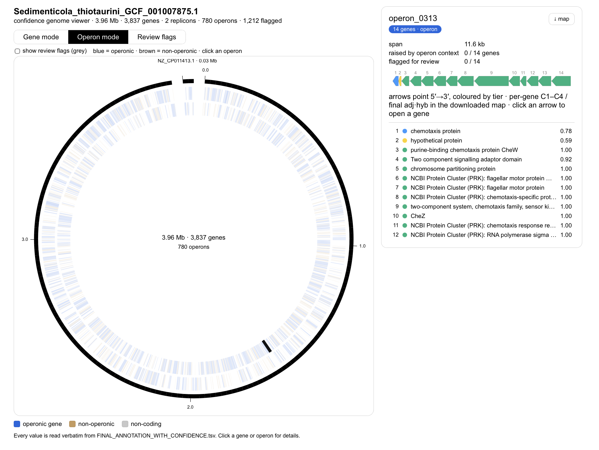
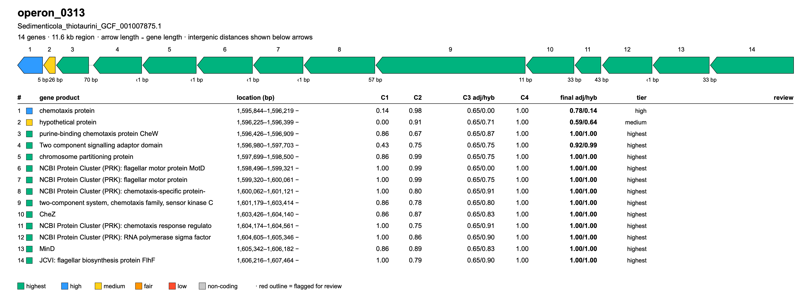

<div align="center">

# MARGIE

**Mostly Automated Rapid Genome Inference Environment**

Annotates prokaryotic genomes, finds operons, and scores how confident she is about each gene.




[](https://snakemake.readthedocs.io/)

<a href="#install"><b>Install</b></a> &nbsp;|&nbsp;
<a href="#configure"><b>Configure</b></a> &nbsp;|&nbsp;
<a href="#run"><b>Run</b></a> &nbsp;|&nbsp;
<a href="#licensing"><b>Licensing</b></a> &nbsp;|&nbsp;
<a href="#the-website"><b>Website</b></a> &nbsp;|&nbsp;
<a href="#ai-usage-in-the-project"><b>AI usage in the project</b></a>

</div>

## Two ways to use MARGIE

| | Best for | Start here |
|---|---|---|
| **The website** | Most people: sign in, start runs on the cluster, read the results. You run it yourself. | [Run the website](../README.md#run-the-website) |
| **Command line** | A terminal on the HPC; no interface. **This page.** | [Install](#install) |

## Scope

This is the **`be-margie/`** folder of [margie-project-2026](https://github.com/Diet-Microbiome-Interactions-Lab/margie-project-2026): MARGIE's backend (pipeline, CLI, API, licensing gate, and runtime/config behaviour). The website runs this code on your HPC cluster when you sign in.
The interface is in [`../fe-margie`](../fe-margie).

## Install

The website does this for you the first time you sign in. By hand, on the cluster:

```bash
git clone https://github.com/Diet-Microbiome-Interactions-Lab/margie-project-2026.git ~/margie-project-2026
ln -s ~/margie-project-2026/be-margie ~/bioinformatics-tools
cd ~/bioinformatics-tools
uv sync
source .venv/bin/activate
```

## Configure

Run it once to create your config file:

```bash
dane_wf                        # creates ~/.config/bioinformatics-tools/config.yaml
```

Open that file and set where results are saved:

```yaml
main_database: path-to-sqlite-database.db
```

`main_database` is the SQLite database file used to store run metadata and results.
It is different from the `output_dir` folder used for generated run files, and different from fingerprint-related databases.

Databases have no default location: set `db_root` (and any per-tool `db.<tool>` paths) in the config. Set `MARGIE_SHARED_ROOT` to your group's shared MARGIE folder when one exists (`margie_sb.shared_root` on the website's Settings page); a new account copies its base databases from there, and empty folders fill up as you run.

On the website, **Settings** edits this file, and its **Edit config.yaml** link opens the whole file for editing by hand. That same config file contains both the shared pipeline paths and the per-tool resource settings (threads, memory, runtime, partition overrides).

For MARGIE(SB), GTDB-Tk should remain on the `highmem` partition because it loads a very large reference database into memory.

### Shared Storage Paths: What They Are, Why They Matter

MARGIE(SB) uses a mix of:

- **Pipeline-critical shared stores** (must be writable, used during scoring/fingerprinting/synteny)
- **Record-keeping stores** (archives/snapshots for reproducibility and review)
- **Presentation-only inputs** (used for report figures; non-fatal if unavailable)

These are configured under `margie_sb.*` in `~/.config/bioinformatics-tools/config.yaml`.

| Config key | Purpose | Category | Required for a successful core run? | Auto-created if missing? |
| --- | --- | --- | --- | --- |
| `main_database` | Stores run metadata + loaded result tables | Pipeline-critical | **Yes** | **File is created by pipeline/sqlite if directory is writable** |
| `margie_sb.operon_database.occ_reference_pkl` | Cross-genome OCC reference used by C3 scoring | Pipeline-critical | **Yes** | **Yes** (seeded on first update from the starter `scoring/reference/operon-db.pkl`, 29 genomes; see its manifest) |
| `margie_sb.fingerprint_database.path` | Shared gene-fingerprint pool across genomes/runs | Pipeline-critical | **Yes** | **Yes** (file initialized on first update) |
| `margie_sb.genome_pool.path` | Shared FASTA/FAA pool used by ANI/AAI/synteny staging | Pipeline-critical | **Yes** | **Directory created as needed** |
| `margie_sb.scoring_results_historical.path` | Immutable per-run scoring history archive | Record-keeping | No (but strongly recommended) | **Directory created as needed** |
| `margie_sb.final_tables_depot.path` | Reviewer-facing `FINAL_ANNOTATION_WITH_CONFIDENCE.tsv` export root | Record-keeping | No (but strongly recommended) | **Directory created as needed** |
| `margie_sb.sqlite_pipeline_snapshot.path` | Destination root for versioned sqlite snapshot queue jobs | Record-keeping | No (but strongly recommended) | **Directory created as needed** |
| `margie_sb.report_figures.operon_db` | Operon-fingerprint DB used by downstream figure scripts | Presentation-only | No (figures are non-fatal) | **No** (this is read-only input) |

### Required vs Optional: Practical Guidance

- **Compulsory for normal MARGIE(SB) operation:**
  - `main_database`
  - `margie_sb.operon_database.occ_reference_pkl`
  - `margie_sb.fingerprint_database.path`
  - `margie_sb.genome_pool.path`
- **Important but not strict blockers for core scoring outputs:**
  - `margie_sb.scoring_results_historical.path`
  - `margie_sb.final_tables_depot.path`
  - `margie_sb.sqlite_pipeline_snapshot.path`
- **Optional/non-fatal presentation input:**
  - `margie_sb.report_figures.operon_db`

### Filename Rules (Canonical Name vs Path-Only)

For file-backed keys (`occ_reference_pkl`, `fingerprint_database.path`, `report_figures.operon_db`), you can now provide either:

- a **full file path** (custom filename allowed), or
- a **directory path only**.

If you provide only a directory path, MARGIE appends a canonical default filename automatically:

- `occ_reference.pkl`
- `fingerprint-database.tsv`
- `operon-fingerprint-database-label-ordered.tsv`

So users do **not** have to type canonical filenames unless they want to override them explicitly.

## Run

```bash
dane_wf margie sb \
  input: path-to-input-folder-or-fasta \
  output_dir: path-to-output-folder \
  run_full_operon_map: true
```

Run it in the background so it survives logout:

```bash
nohup dane_wf margie sb input: path-to-input-folder-or-fasta output_dir: path-to-output-folder run_full_operon_map: true > margie.log 2>&1 &
```

Watch it: `tail -f margie.log`  —  Stop it: `pkill -f dane_wf`

## Licensing

On the **first run**, MARGIE shows the licensing terms and **every tool/database's license**, then asks you to accept and to tell it:

- how you'll use MARGIE — **academic/non-profit** or **commercial**, and
- which license-required tools you've obtained yourself (Phobius, SignalP 4/6, MEROPS; plus TMbed/TCDB/KEGG for commercial use).

Tools you're not licensed for are **automatically disabled**.

> [!IMPORTANT]
> Accept it once in a real terminal — a background/`nohup` first run will stop and ask you to accept interactively.

Your acceptance is saved to `~/.config/bioinformatics-tools/` and archived (with the exact licenses shown) under `~/.local/share/bioinformatics-tools/licensing-records/`. The backend's secret keys are also created automatically in a git-ignored `.env` on first run — there is no manual key step.

## The website

MARGIE's website runs this backend for you: it signs in to your cluster account over SSH, clones this repository into your home folder the first time, and starts each run there. It uses the same licensing acceptance described above. How to run it: [Run the website](../README.md#run-the-website).

## Notes

- `margie sb` is two words. `output_dir:` is the exact folder (no timestamp added).
- Resume a crashed run: add `margie_sb.resume: true`.
- Choose the tools: add `margie_sb.selected_tools:` with their names, separated by commas, for example `margie_sb.selected_tools: gtdbtk,rasttk,pfam,operon,consolidation,labeling,fingerprint,scoring_heuristic`. Every name, by phase: [Choosing the tools](../README.md#choosing-the-tools).
- Full toolkit (file tools, API, front-end): [README-detailed.md](README-detailed.md).

## AI usage in the project

Phase 9-12 scripts were designed and implemented by **Sajal Bhattarai**.
During script development, **Claude Sonnet 4.6** was used in interactive mode to improve robustness and debug issues.
The core ideas, architecture, and intended behavior were defined by Sajal Bhattarai.
These scripts were manually validated for intended behavior.

Visualization and LLM work, including the operon circular diagram page, HTML creation, and interactive chat mode, were refined with interactive-mode assistance from **Claude Opus 4.8**.
These components were also manually checked and validated for intended purpose.

## Disclaimer

This software is provided "as is", without warranty of any kind, express or implied, including but not limited to warranties of merchantability, fitness for a particular purpose, and noninfringement.

## Cite This Repository

APA 7th (this pipeline):

Bhattarai, S., Deemer, D., & Lindemann, S. R. (2026). *MARGIE: Mostly Automated Rapid Genome Inference Environment* [Computer software]. Purdue University. https://github.com/Diet-Microbiome-Interactions-Lab/margie-project-2026

APA 7th (thesis, in which MARGIE was first built):

Bhattarai, S. (2026). *Mostly Automated Rapid Genome Inference Environment* [Thesis, Purdue University]. Purdue University Graduate School. https://doi.org/10.25394/PGS.33103682.v1

APA 7th (the code and data as the thesis used and cites them):

- Bhattarai, S., Deemer, D., & Lindemann, S. (2026a). *bioinformatics-tools* (Version 1.0.0) [Computer software]. https://github.com/sajalbhattarai/bioinformatics-tools/releases/tag/v.1.0.0
- Bhattarai, S., Deemer, D., & Lindemann, S. (2026b). *biolab-fe* (Version 1.0.0) [Computer software]. https://github.com/sajalbhattarai/biolab-fe/releases/tag/v1.0.0
- Bhattarai, S., Deemer, D., & Lindemann, S. (2026c). *Mostly Automated Rapid Genome Inference Environment* [Dataset]. Zenodo. https://doi.org/10.5281/zenodo.21632205 (embargoed until 30 August 2028)

APA 7th (base architecture on which MARGIE was built, by Dane Deemer):

- Deemer, D. (2020). *bioinformatics-tools* [Computer software]. GitHub. https://github.com/wintermutant/bioinformatics-tools (the backend that be-margie grew from: API, command line and workflow engine)
- Deemer, D. (2025). *biolab-fe* [Computer software]. GitHub. https://github.com/wintermutant/biolab-fe (the web interface that fe-margie grew from)

APA 7th (research computing, as RCAC asks it to be cited):

- McCartney, G., Hacker, T., & Yang, B. (2014). Empowering faculty: A campus cyberinfrastructure strategy for research communities. *EDUCAUSE Review*. https://er.educause.edu/articles/2014/7/empowering-faculty-a-campus-cyberinfrastructure-strategy-for-research-communities
- Smith, P. M., Gough, E., Younts, A., Werts, B., Hacker, T. J., Neumeister, N., & Wisecaver, J. (2020). The “Geddes” composable platform: An evolution of community clusters for a composable world. *2020 IEEE/ACM International Workshop on Interoperability of Supercomputing and Cloud Technologies (SuperCompCloud)*, 33–38. https://doi.org/10.1109/SuperCompCloud51944.2020.00011
- Rosen Center for Advanced Computing. (n.d.). *Negishi* [Community cluster]. Purdue University. Retrieved October 25, 2026, from https://www.rcac.purdue.edu/compute/negishi

BibTeX:

```bibtex
@article{Bhattarai2026,
author = "Sajal Bhattarai",
title = "{MOSTLY AUTOMATED RAPID GENOME INFERENCE ENVIRONMENT}",
year = "2026",
month = "7",
url = "https://hammer.purdue.edu/articles/thesis/_b_MOSTLY_AUTOMATED_RAPID_GENOME_INFERENCE_ENVIRONMENT_b_/33103682",
doi = "10.25394/PGS.33103682.v1"
}
@software{Bhattarai2026aBioinformaticsTools,
author = "Sajal Bhattarai and Dane Deemer and Stephen Lindemann",
title = "{bioinformatics-tools}",
version = "1.0.0",
year = "2026",
url = "https://github.com/sajalbhattarai/bioinformatics-tools/releases/tag/v.1.0.0"
}
@software{Bhattarai2026bBiolabFe,
author = "Sajal Bhattarai and Dane Deemer and Stephen Lindemann",
title = "{biolab-fe}",
version = "1.0.0",
year = "2026",
url = "https://github.com/sajalbhattarai/biolab-fe/releases/tag/v1.0.0"
}
@misc{Bhattarai2026cData,
doi = {10.5281/ZENODO.21632205},
url = {https://zenodo.org/doi/10.5281/zenodo.21632205},
author = {Bhattarai, Sajal and Deemer, Dane and Lindemann, Stephen},
title = {Mostly Automated Rapid Genome Inference Environment},
publisher = {Zenodo},
year = {2026},
note = {Embargoed until 2028-08-30}
}
@software{Deemer2020,
author = "Dane Deemer",
title = "{bioinformatics-tools}",
year = "2020",
publisher = "GitHub",
url = "https://github.com/wintermutant/bioinformatics-tools"
}
@software{Deemer2025,
author = "Dane Deemer",
title = "{biolab-fe}",
year = "2025",
publisher = "GitHub",
url = "https://github.com/wintermutant/biolab-fe"
}
@article{McCartney2014,
author = {McCartney, Gerry and Hacker, Thomas and Yang, Baijian},
journal = {Educause Review},
title = {{Empowering Faculty: A Campus Cyberinfrastructure Strategy for Research Communities}},
year = {2014},
url = {https://er.educause.edu/articles/2014/7/empowering-faculty-a-campus-cyberinfrastructure-strategy-for-research-communities}
}
@inproceedings{Smith2020Geddes,
title = {The “Geddes” Composable Platform - An Evolution of Community Clusters for a Composable World},
url = {http://dx.doi.org/10.1109/SuperCompCloud51944.2020.00011},
DOI = {10.1109/supercompcloud51944.2020.00011},
booktitle = {2020 IEEE/ACM International Workshop on Interoperability of Supercomputing and Cloud Technologies (SuperCompCloud)},
publisher = {IEEE},
author = {Smith, Preston M. and Gough, Erik and Younts, Alexander and Werts, Brian and Hacker, Thomas J. and Neumeister, Norbert and Wisecaver, Jennifer},
year = {2020},
month = nov,
pages = {33--38}
}
@misc{RCACNegishi,
author = {{Rosen Center for Advanced Computing}},
title = {Negishi community cluster},
howpublished = {Purdue University},
url = {https://www.rcac.purdue.edu/compute/negishi},
note = {Accessed 2026-10-25}
}
```

Use the exact version you ran by checking repository Releases, and include that release version number in your citation.

Please also cite the individual tools and databases you use in the MARGIE pipeline, in accordance with their licensing and referencing requirements. The licensing gates during MARGIE runs provide the relevant licensing details, but you should still cross-check and confirm the requirements before publication.

For machine-readable repository metadata, see [CITATION.cff](../CITATION.cff).

## Acknowledgements

I (Sajal) gratefully acknowledge Dane Deemer ([wintermutant](https://github.com/wintermutant)) for his mentoring, and the design and development of the engine and GUI orchestration platform on which the MARGIE(SB) workflow was built. 

Special thanks goes to Dr. Stephen R Lindemann for his vision, supervision  and support throughout this development.
I also thank members of Diet-Microbiome-Interactions Laboratory for their feedbacks and intellectual inputs during this development.

MARGIE's runs use research computing resources of the Rosen Center for Advanced Computing (RCAC), Information Technology at Purdue University: the Negishi community cluster and the Geddes Community Composable Platform, which the National Science Foundation funded under award [OAC-2018926](https://www.nsf.gov/awardsearch/showAward?AWD_ID=2018926) (CC* Compute: Private Campus Cloud for Data Analytics and Machine Learning). We thank RCAC and its staff for these resources and their support.

MARGIE was developed with support from the U.S. National Science Foundation under [Grant No. 2125155](https://www.nsf.gov/awardsearch/showAward?AWD_ID=2125155) (MIM: Microbial Division of Labor in Polysaccharide-Degrading Communities) and the National Institute of General Medical Sciences of the National Institutes of Health under [Award No. R35 GM133634](https://reporter.nih.gov/project-details/10645210) (Carbohydrate Structure Controls on Human Gut Microbial Ecology); PI: Stephen R. Lindemann.

We also thank the developers and maintainers of the upstream tools, databases, and scientific software used throughout the pipeline. Their contributions make reproducible computational biology more powerful, more accessible, and more exciting to do.
